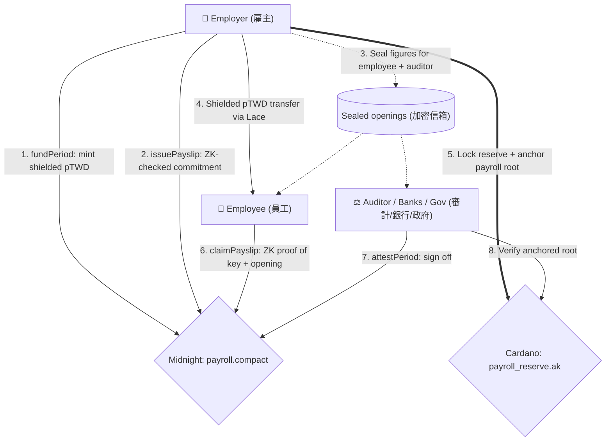

# On-Chain Payroll 🛡️

**Enterprise-Grade Privacy-Preserving Salary Distribution System**  
**企業級隱私鏈上薪資發放系統 (MVP)**


## 📖 Project Overview (專案簡介)
On-Chain Payroll is a next-generation HR and financial compliance platform built for the Web3 era. Salaries are issued on **Midnight**, where a Compact contract proves every payslip follows the payroll rules in zero knowledge while keeping all amounts private. The period's reserve and the Midnight payroll root are anchored on **Cardano**, so banks and tax authorities can verify the payroll there.

本專案是一個專為 Web3 時代打造的新世代企業薪資發放與財務合規平台。薪資在 **Midnight** 上發放：Compact 合約以零知識證明保證每張薪資單符合計算規則，同時讓所有金額保持隱私。當期準備金與 Midnight 薪資根雜湊則錨定在 **Cardano** 上，讓銀行與政府機關可以在 Cardano 上查驗。

## 🔄 System Architecture (系統運作流程)


## 🔐 Privacy Model (隱私機制)

| What | Where | Visible to |
| --- | --- | --- |
| Salary figures (base, allowance, bonus, deductions, net) | Caller's private state + sealed off-chain copies | Employee and auditor only |
| Payslip commitment `persistentCommit(figures, salt)` | Midnight ledger | Everyone |
| Proof that deductions follow the rates and net = gross − deductions | Midnight transaction (ZK proof) | Everyone (reveals nothing else) |
| Who claimed which payslip | Midnight ledger (status) | Everyone |
| Salary payments | Shielded pTWD transfers on Midnight | Sender and recipient only |
| Period budget (aggregate) | Midnight `periodBudgets` + Cardano datum | Everyone |
| Payroll root (hash chain of commitments) | Midnight `periodRoots`, anchored in the Cardano datum | Everyone |

* **Midnight contract** ([`contracts/midnight/src/payroll.compact`](contracts/midnight/src/payroll.compact)): `issuePayslip` checks inside the proof that labor insurance (2.5%), health insurance (1.5%) and income tax (5%) are computed correctly and that net pay matches. Only the employer key can issue or fund, only the employee key can claim, and only the auditor key can sign off.
* **Off-chain distribution** ([`lib/privacy.ts`](lib/privacy.ts)): the opening (figures + salt) is sealed with ECDH P-256 + AES-256-GCM for the employee and the auditor. Each reader re-runs the contract's `payslipCommitment` circuit to check their copy against the ledger.
* **Cardano reserve** ([`contracts/cardano/validators/payroll_reserve.ak`](contracts/cardano/validators/payroll_reserve.ak)): `Anchor` (employer re-anchors a newer root; funds and other fields cannot change), `Release` (employer + auditor), `Reclaim` (employer, after the unlock time).
* **Verifiable PDF**: the payslip includes the contract address, payslip id, commitment and salt, so a bank or tax office can check it against Midnight.

> MVP note: this single-browser demo plays every role, so the Midnight secret keys, sealed-box keys and private state live in `localStorage`. In production each key stays in its owner's wallet.

## 🌐 Network Modes (網路模式)
Switch with the **Local / Preprod** toggle in the navigation bar.

| | Local (本機) | Preprod |
| --- | --- | --- |
| Midnight | Compiled `payroll.compact` circuits run in the browser via `compact-runtime` (same rules, no proofs) | Real transactions via Lace (DApp Connector API 4.x) and Midnight.js 4.1.1 |
| Cardano | Reserve simulated with the validator's rules | `payroll_reserve` on Cardano Preprod via any CIP-30 wallet (Mesh SDK) |
| Needs | Nothing | Lace with Midnight Preprod + tDUST, a CIP-30 wallet with test ADA and collateral |

## 🚀 Getting Started (本地執行)
```bash
npm install
npm run dev
```
Open http://localhost:3000. Demo employee accounts: `Aden`, `Alice`, `Bob`. Local mode works immediately.

### Preprod (測試網)
1. Install [Lace](https://www.lace.io/) with Midnight enabled, switch it to **Preprod** and get tNIGHT from the Midnight faucet so it generates tDUST.
2. For the Cardano reserve, use a CIP-30 wallet (Lace, Eternl, …) on **Preprod** with test ADA from the Cardano faucet and a collateral UTxO set.
3. If your wallet does not prove transactions itself, run a proof server:
   ```bash
   docker run -p 6300:6300 midnightntwrk/proof-server:8.1.0 midnight-proof-server -v
   ```
4. Switch the app to **Preprod**, open the Employer Portal, connect Lace and click **Deploy Payroll Contract**. Copy `.env.example` to `.env.local` and set `NEXT_PUBLIC_PAYROLL_CONTRACT` to share the deployed contract across browsers.
5. Fund the period, issue payslips, then lock the reserve and anchor the root on Cardano.

## 🧪 Development (開發)
| Command | What it does |
| --- | --- |
| `npm run contract:compile` | Compile `payroll.compact` with Compact 0.31.1 and sync the ZK keys to `public/` |
| `npm run contract:test` | Run the Compact contract in the simulator (11 tests) |
| `npm run chain:test:local` | Exercise the browser backend end to end under Node |
| `npm run cardano:test` | Aiken unit tests for `payroll_reserve` (12 tests) |
| `npm run cardano:test:offchain` | Build real Mesh transactions and evaluate the compiled Aiken script on them (9 checks) |
| `npm run cardano:build` | Rebuild `plutus.json` |

Toolchain: Compact devtools 0.5.1 with compiler **0.31.1** (`compact update 0.31.1`; 0.34+ targets Ledger 9 and cannot deploy to the current networks), Aiken **1.1.23** (installed through npm), Node 24.

```
contracts/midnight/   payroll.compact, witnesses, simulator tests, compiled output (managed/)
contracts/cardano/    payroll_reserve.ak, plutus.json
lib/chain/            local + Preprod backends, Cardano reserve tx builders, React hook
lib/privacy.ts        sealed boxes for off-chain openings
app/                  portals (page.tsx) and chain panels
```

## 🗺️ Roadmap (未來藍圖)
1. **Wallet-held keys:** derive the Midnight secret key and sealed-box keys from the connected wallet instead of the demo vault.
2. **On-chain mailbox:** move sealed openings from `localStorage` to IPFS or contract state for multi-device access.
3. **Separate auditor wallet:** collect the auditor's Cardano signature for `Release` in its own wallet (the builder already supports partial signing).
4. **B2B / B2G APIs:** open the bank and Gov/CPA gateways for loan scoring and tax verification against the anchored roots.

---
*Built for the future of decentralized organizations.*
