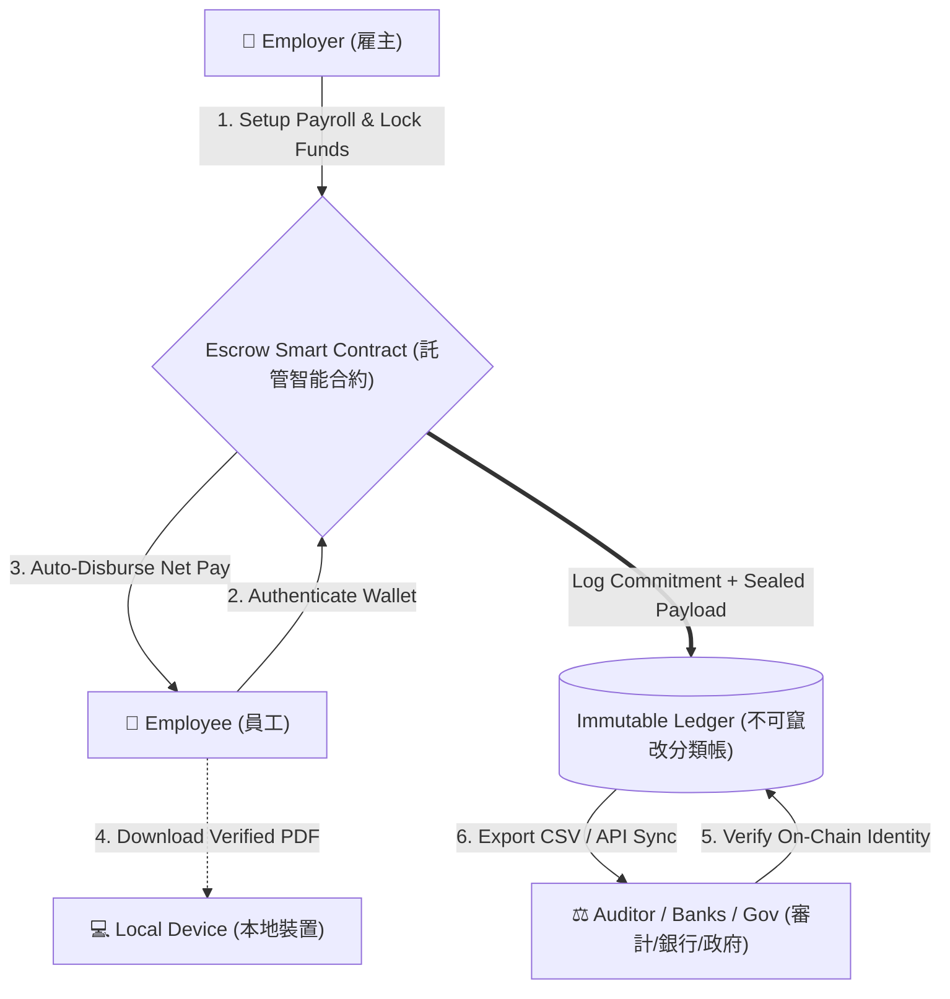

# On-Chain Payroll 🛡️

**Enterprise-Grade Privacy-Preserving Salary Distribution System**  
**企業級隱私鏈上薪資發放系統 (MVP)**


## 📖 Project Overview (專案簡介)
On-Chain Payroll is a next-generation HR and financial compliance platform built for the Web3 era. It leverages blockchain technology to ensure secure, immutable, and privacy-preserving salary disbursements while providing seamless auditing interfaces for traditional finance and government entities.

本專案是一個專為 Web3 時代打造的新世代企業薪資發放與財務合規平台。透過區塊鏈技術，確保薪資發放的安全、不可竄改與隱私保護，同時為傳統金融與政府審計機關提供完美的查核介面。

## 🔄 System Architecture (系統運作流程)


## 🔐 Privacy Model (隱私機制)
Salary figures never appear on the ledger in plaintext. All cryptography runs in the browser via the Web Crypto API ([`lib/privacy.ts`](lib/privacy.ts)).

薪資數字不會以明文出現在分類帳上，所有加解密皆於瀏覽器端以 Web Crypto API 完成。

| Step | What happens |
| --- | --- |
| **Seal (封裝)** | The employer encrypts the payslip separately for the employee and the auditor using ECDH P-256 + AES-256-GCM (one ephemeral key per box). |
| **Commit (承諾)** | Only `SHA-256(salt \| figures)` is published as the ledger record's commitment. |
| **Reveal (揭露)** | Each party decrypts with its own private key. Nobody else, including other employees, can read the amounts. |
| **Verify (驗證)** | The decrypted figures are re-hashed and compared to the commitment. Any tampering is flagged in the employee and auditor views. |
| **Disclose (選擇性揭露)** | The PDF payslip includes the commitment and salt, so a bank or tax office can verify the figures without ledger access. |

> MVP note: the keystore lives in `localStorage` to stand in for each party's wallet. In production every private key stays in its owner's wallet and only public keys go to the on-chain registry.

## ✨ Features (功能)
### 1. Employer Portal (雇主發放入口)
* Auto-calculated net pay (labor insurance, health insurance, income tax) with a discretionary bonus.
* Duplicate-payout protection: a claimed period cannot be paid again.
* **Public Ledger View:** shows exactly what the network sees: employee, commitment and status, never amounts.

### 2. Employee Portal (員工提領入口)
* Wallet-bound identity; payslips are decrypted locally with the employee's own key.
* Claim net pay to the connected wallet and download a verifiable PDF payslip.

### 3. Auditor & Compliance Portal (財務合規與審計入口)
* Regulator view key decrypts every record; each row is checked against its commitment.
* 1-click CSV export (with a commitment verification column), with reserved gateways for **Banks** and **Gov/CPA**.

## 🚀 Getting Started (本地執行)
```bash
npm install
npm run dev
```
Open http://localhost:3000. Demo employee accounts: `Aden`, `Alice`, `Bob`.

## 🗺️ Roadmap (未來藍圖)
1. **Smart Contract Integration:** move the ledger from LocalStorage to a real escrow contract.
2. **Privacy Network Deployment:** deploy on a privacy-preserving chain (e.g. Midnight) and replace the hash commitment with ZK proofs.
3. **Wallet-held keys:** derive encryption keys from the connected wallet instead of the demo keystore.
4. **B2B / B2G APIs:** open the bank and Gov/CPA gateways for loan scoring and tax verification.

---
*Built for the future of decentralized organizations.*
